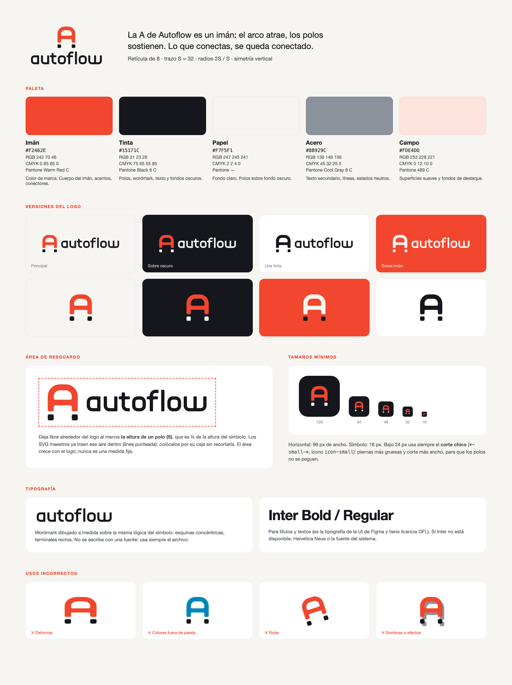
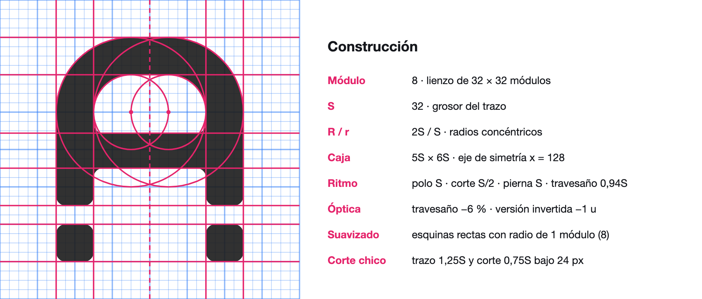
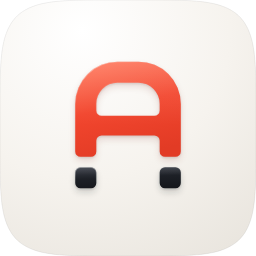

# Autoflow · Guía de marca



## 1. La idea

**La A de Autoflow es un imán de herradura: el arco atrae y los polos sostienen.** Lo que conectas, se queda conectado.
El símbolo usa el vocabulario del producto, porque Figma llama "imanes" a los puntos donde se engancha un conector.

- **Versiones:** horizontal (principal), apilada, solo símbolo y solo wordmark.
- **Firma:** "Conectores que no se sueltan."

## 2. Construcción



| Regla | Valor |
| --- | --- |
| Retícula | Lienzo de 256 con módulos de 8 |
| Trazo | S = 32 (4 módulos) |
| Arco | Radio exterior 2S y radio interior S, concéntricos |
| Caja | 5S × 6S, simétrica respecto de x = 128 |
| Ritmo (de abajo hacia arriba) | Polo S · corte S/2 · pierna S · travesaño 0,94S |
| Suavizado | Toda esquina recta lleva radio de 1 módulo (8 = S/4) |
| Corrección óptica | Travesaño un 6 % más delgado; versión invertida 1 u más fina por irradiación |
| Corte chico (≤ 24 px) | Trazo 1,25S y corte 0,75S, para que los polos no se peguen |

El wordmark se dibujó a medida con la misma lógica: curvas con radios concéntricos y esquinas suavizadas a ¼ de su trazo.
**No se escribe con una fuente:** siempre se usa el archivo.

En el horizontal, la **línea base del wordmark coincide con el corte del imán** y la separación entre símbolo y texto es 1,5S.
En el apilado, el wordmark va centrado a S por debajo de los polos.

## 3. Color

| Nombre | HEX | RGB | CMYK | Pantone (aprox.) | Uso |
| --- | --- | --- | --- | --- | --- |
| **Imán** | `#F2462E` | 242 70 46 | 0 85 85 0 | Warm Red C | Color de marca: cuerpo del imán, acentos, conectores |
| **Tinta** | `#15171C` | 21 23 28 | 75 65 55 85 | Black 6 C | Polos, wordmark, texto, fondos oscuros |
| **Papel** | `#F7F5F1` | 247 245 241 | 2 2 4 0 | — | Fondo claro; polos sobre fondo oscuro |
| **Acero** | `#8B929C` | 139 146 156 | 45 32 25 5 | Cool Gray 8 C | Texto secundario, líneas, estados neutros |
| **Campo** | `#FDE4DD` | 253 228 221 | 0 12 10 0 | 489 C | Superficies suaves y fondos de destaque |

Los valores CMYK y Pantone son aproximados. Antes de imprimir, verifícalos con una guía física.

**Contraste:**
- Imán sobre Papel: 3,4:1. Sobre blanco: 3,7:1. Sobre Tinta: 4,9:1. Sirve para gráficos y texto grande (24 px o más, o 19 px bold). El texto de párrafo en Imán solo va sobre Tinta.
- Acero sobre Papel: 2,9:1. Úsalo solo para líneas y elementos decorativos, no para texto importante.

**Pares aprobados de logo y fondo:**

| Fondo | Archivo |
| --- | --- |
| Papel o blanco | `*-color` (cuerpo Imán, polos Tinta) |
| Tinta | `*-on-dark` (cuerpo Imán, polos Papel, trazo afinado) |
| Imán | `autoflow-symbol-on-iman` (cuerpo Papel, polos Tinta) o `*-white` |
| Impresión a una tinta | `*-black`, `*-white` o `autoflow-symbol-iman` |

## 4. Área de resguardo y tamaños mínimos

- **Área de resguardo:** deja libre al menos **S** (la altura de un polo) por cada lado. Los SVG maestros ya incluyen ese aire en su `viewBox`: colócalos por su caja y no la recortes.
- **Horizontal:** 96 px de ancho mínimo en pantalla y 25 mm en impresión.
- **Símbolo:** 16 px de mínimo. **Bajo 24 px usa siempre el corte chico** (`autoflow-symbol-small-*`, `figma/icon-small.svg`, `web/favicon.svg`).

## 5. Tipografía

- **Wordmark:** dibujado a medida (`logo/autoflow-wordmark*.svg`).
- **Títulos y textos:** Inter Bold y Regular. Es la tipografía de la UI de Figma y tiene licencia OFL. Si no está disponible, usa Helvetica Neue o la fuente del sistema.
- Las imágenes de `publish/` usan Inter, que va incluida en `publish/src/fonts/` con su licencia OFL.

## 6. Usos incorrectos

No deformes ni rotes el logo. No cambies los colores fuera de la paleta. No pintes los polos del color del cuerpo en la versión a color: los polos oscuros son lo que hace que se lea como imán. No agregues sombras, contornos ni degradados. No reordenes ni cambies el tamaño de las partes de un lockup. No escribas "autoflow" con una fuente para reemplazar el wordmark.

## 7. Ícono Liquid Glass (Icon Composer)

 

El ícono del plugin sigue el lenguaje de Icon Composer de macOS. La idea es la contención: el color está en el vidrio y la placa es la del sistema.

- **Placa:** un squircle de curvatura continua (superelipse, n = 5). En claro tiene un degradado radial de blanco a Papel cálido; en oscuro, de grafito a Tinta.
- **Cuerpo:** vidrio rojo iluminado desde arriba a la izquierda. El degradado va de coral anaranjado (`#FFB08C`) a Imán y a carmín (`#CF2626`). Tiene un brillo en la mitad superior, un solo borde especular (más intenso arriba a la izquierda), un destello en el hombro del arco y un rebote de luz en la base.
- **Polos:** vidrio ahumado (Tinta) en claro y vidrio plateado en oscuro, con el mismo brillo y el mismo borde. Están un poco más adelante que el cuerpo, así que su sombra es un poco más larga.
- **Sombras:** en claro, la sombra del cuerpo tiene un tinte rojo suave, como la luz que pasa por un vidrio de color. En oscuro es neutra. Siempre hay una sombra de contacto corta. **No se usa brillo exterior (glow), biseles ni bordes oscuros.**
- **Bajo 48 px** se usa el ícono plano (`figma/icon-small.svg`, favicons): el detalle del vidrio no sobrevive a ese tamaño.

| Archivo | Uso |
| --- | --- |
| `glass/glass-icon-light.svg` / `-dark.svg` | Maestros con squircle; PNG de 128 a 1024 px |
| `glass/glass-icon-*-square.svg` | A sangre, para Figma (que redondea el ícono). `glass-icon-light-square.svg` es `publish/icon.svg` |
| `glass/glass-symbol.svg` | Símbolo de vidrio sin placa (`publish/logo.svg`, portada y carrusel) |
| `icon-composer/` | Fondo y una capa plana por pieza (`01-body`, `02-poles`), sin máscara, en el lienzo de 1024. Impórtalas en Icon Composer para que el sistema genere el Liquid Glass de verdad, con sus variantes clara, oscura y tintada |

Los archivos de vidrio usan degradados y filtros de desenfoque. Donde no se admitan filtros SVG, usa los PNG. La fuente es `glass.py`.

## 8. Archivos

```
logo/    símbolo (color, on-dark, black, white, iman, on-iman, small-*), horizontal-*, stacked-*, wordmark  · SVG + PNG
figma/   ícono plano en placa Tinta (icon.svg, icon-small.svg ≤ 32 px, PNG 128/256)
glass/   ícono Liquid Glass claro y oscuro (squircle y a sangre), símbolo de vidrio · SVG + PNG
icon-composer/  capas planas para Icon Composer
web/     favicon.svg/.ico/16/32/48, apple-touch-icon, icon-192/512, maskable-512, site.webmanifest, head-snippet.html
sheets/  brand-sheet.png, construction.png, presentation.html + slides/ (mockups de uso)
```

**Figma Community:** la ficha completa (ícono, portada, carrusel y textos) está en `Autoflow/publish/`, con el mismo formato que los demás plugins y en inglés, como la UI. Ver `publish/LISTING.md`.

**Regenerar todo:** la fuente única es `geometry.py`, que contiene el símbolo, más `wordmark.py`. `build_kit.py` escribe los SVG, `glass.py` el ícono de vidrio y `./render.sh` vuelve a generar todos los PNG e ICO. Para eso usa los scripts de la skill `logo-design` (`LOGO_SKILL=<ruta>` si está en otro lugar) y Chrome.

## 9. Pendientes

- **Nombre:** ya existe en Figma Community un plugin pagado llamado *Autoflow* (de David Zhao y Yitong Zhang). Antes de publicar, revisa el nombre o agrégale algo que lo diferencie. La marca funciona igual con otro nombre que empiece con A; el wordmark se puede redibujar con `wordmark.py`.
- **Marca registrada:** no se hizo una búsqueda de registro. Haz una búsqueda profesional antes de usar la marca comercialmente.
- **Impresión:** no hay masters en PDF, AI o EPS. Si los necesitas, abre los SVG en Illustrator o Figma y expórtalos desde ahí.
